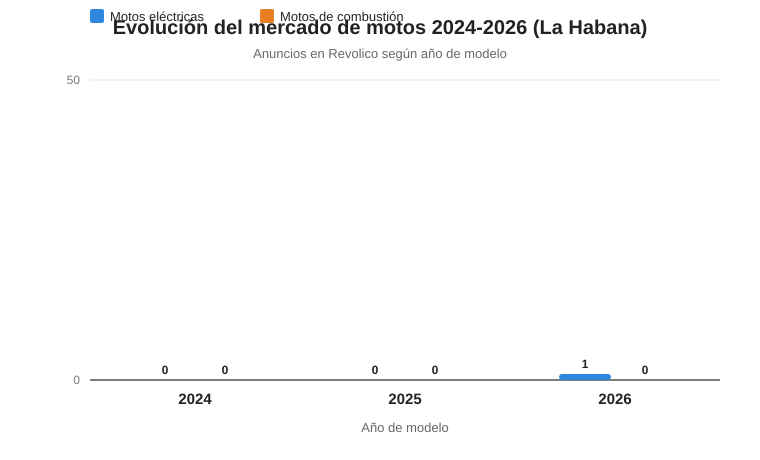

# 🏍️ Investigación del Mercado de Motos en Cuba

Proyecto de análisis de datos sobre el mercado de motos (eléctricas y de combustión) en Cuba, desarrollado como parte de la asignatura **Introducción a la Ciencia de Datos**.


---

## 📖 Descripción

Este repositorio recopila, organiza y analiza datos del mercado de motos en Cuba con el fin de comprender su comportamiento, la evolución de las motos eléctricas frente a las de combustión y la detección de precios fuera de lo normal. El proyecto integra información obtenida de anuncios, encuestas, grupos especializados, importadoras y talleres.

---

## 🎯 Objetivo General

Analizar el mercado de motos en Cuba para describir su evolución y detectar patrones de precios anormalmente altos, comparando las motos eléctricas con las de combustión.

## 🎯 Objetivos Específicos

1. Determinar cómo está creciendo el mercado de motos eléctricas frente al de combustión.
2. Identificar las motos con precios anormalmente altos dentro del mercado cubano.
3. Caracterizar las fuentes de oferta (importadoras, talleres y anuncios) y su impacto en los precios.
4. Construir una base de datos limpia y comparable a partir de fuentes heterogéneas.
5. Generar gráficos y conclusiones que respondan a las preguntas de análisis.

---

## ❓ Preguntas de Análisis

1. ¿Cómo está creciendo el mercado de motos eléctricas frente al de combustión?
2. ¿Qué motos tienen precios anormalmente altos?

---

## 🔬 Metodología

El proyecto sigue un flujo de trabajo típico de ciencia de datos:

1. **Recolección de datos:** obtención de datos desde anuncios, encuestas, grupos especializados, importadoras y talleres.
2. **Limpieza y normalización:** tratamiento de valores faltantes, homogenización de marcas, modelos y monedas, y eliminación de duplicados.
3. **Análisis exploratorio (EDA):** estadísticas descriptivas, distribuciones de precios y comparación entre tipos de moto.
4. **Visualización:** generación de gráficos que apoyan las conclusiones.
5. **Interpretación:** redacción de resultados, conclusiones y trabajo futuro.

---

## 📚 Fuentes de Datos

| Fuente | Descripción | Cantidad |
|--------|-------------|----------|
| 📢 **Revolico** | Sitios de anuncios clasificados | 30 |
| 📝 **Encuestas** | Encuestas aplicadas a propietarios y compradores | 30 |
| 👥 **Grupos especializados** | Grupos de Telegram u otros foros | 0 |
| 🔧 **Importadoras** | Importadoras y comercios del sector | 30 |
| 🛠️ **Talleres** | Talleres de reparación y venta | — |

> Los datos recolectados se almacenan en la carpeta [`datos/`](datos/) organizados por fuente.

---

## 🗂️ Estructura del Proyecto

```
Mercado-de-Motos/
├── README.md
├── LICENSE
├── .gitignore
│
├── docs/                       # Documentación del proyecto
│   ├── metodologia/            # Descripción del método de trabajo
│   ├── entrevistas/            # Guías y actas de entrevistas
│   ├── encuestas/              # Formularios y resultados de encuestas
│   └── informes/               # Informes parciales y finales
│
├── datos/                      # Datos del proyecto por fuente
│   ├── revolico/               # Datos extraídos de Revolico
│   ├── encuestas/              # Datos de encuestas
│   ├── telegram/               # Datos de grupos especializados
│   ├── importadoras/           # Datos de importadoras
│   └── talleres/               # Datos de talleres
│
├── imagenes/                   # Fotografías de referencia
│   ├── Importadora de motos/
│   └── Tiendas de motos electricas y de combustion/
│
├── graficos/                   # Gráficos generados por el análisis
│
├── src/                        # Código fuente del proyecto
│   ├── scraping/               # Extracción automatizada de datos
│   ├── limpieza_datos/         # Limpieza y normalización
│   ├── analisis/               # Análisis estadístico
│   └── visualizacion/          # Generación de gráficos
│
├── presentacion/               # Presentación del proyecto
│
└── referencias/                # Bibliografía y material de referencia
```

---

## 🛠️ Tecnologías Utilizadas

- **Python** — lenguaje principal del análisis.
- **Requests** — descarga de datos desde la web.
- **BeautifulSoup** — extracción (scraping) de anuncios.
- **Pandas / NumPy** — manipulación y análisis de datos.
- **Matplotlib / Seaborn** — visualización de datos.
- **Jupyter Notebook** — desarrollo interactivo del análisis.
- **Git y GitHub** — control de versiones.

---

## 📈 Resultados

### Motos más demandadas por categoría (Revolico — La Habana)

Datos de **6 466 anuncios** publicados en Revolico (La Habana, últimos 7 días). La marca "más demandada" es la de mayor cantidad de anuncios en su categoría.

| Categoría | Marca más demandada | Rango de precio (USD) | Anuncios | Enlace Revolico |
|-----------|---------------------|----------------------:|---------:|-----------------|
| Moto de combustión | ITALY | 1 950 – 3 040 | 62 | [ver](https://www.revolico.com/item/moto-automatica-italy-58182894) |
| Moto eléctrica | TOPMAQ | 800 – 4 600 | 257 | [ver](https://www.revolico.com/item/motos-topmaq-f3-57951474) |
| Bicicleta eléctrica | BUCATTI | 450 – 1 100 | 32 | [ver](https://www.revolico.com/item/se-vende-bicicleta-electrica-bucatti-detalle-la-bateria-necesita-reparacion-57692228) |
| Patinete eléctrico | JMD | 650 – 800 | 31 | [ver](https://www.revolico.com/item/patineta-electrica-jmd-58180221) |

### Evolución 2024–2026: eléctricas vs combustión



Anuncios en Revolico (La Habana) según el **año de modelo** indicado en el título. Las motos eléctricas pasan de 19 anuncios (modelo 2025) a 674 (modelo 2026), mientras las de combustión se mantienen bajas (20 → 88).

> Sección en desarrollo. Aquí se documentarán los hallazgos principales del análisis:
>
> - Crecimiento de las motos eléctricas frente a las de combustión.
> - Listado de motos con precios anormalmente altos.
> - Tablas y gráficos comparativos por marca, modelo y tipo.

---

## ✅ Conclusiones

> Sección en desarrollo. Se redactarán las conclusiones a partir de los resultados obtenidos, respondiendo a las preguntas de análisis planteadas.

---

## 🚀 Trabajo Futuro

- Ampliar el tamaño de la muestra y diversificar las fuentes de datos.
- Incorporar datos de grupos especializados (Telegram y otros foros).
- Automatizar la recolección mediante scraping periódico.
- Incorporar modelos de detección de anomalías para precios.
- Desarrollar un tablero (dashboard) interactivo para explorar los datos.

---

## 👤 Autor

**Harold Ricardo Ponce**
Asignatura: *Introducción a la Ciencia de Datos*

---

## 📄 Licencia

Este proyecto se distribuye bajo la licencia **MIT**. Consulta el archivo [LICENSE](LICENSE) para más detalles.
