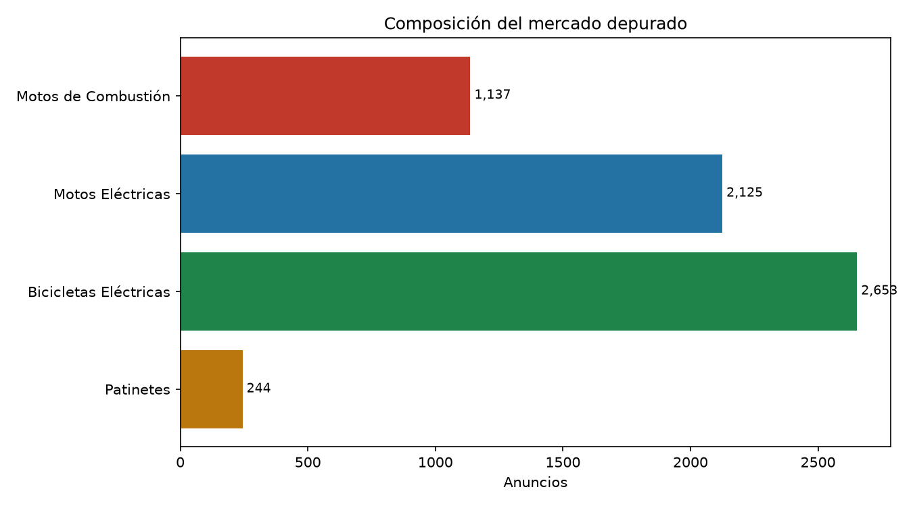
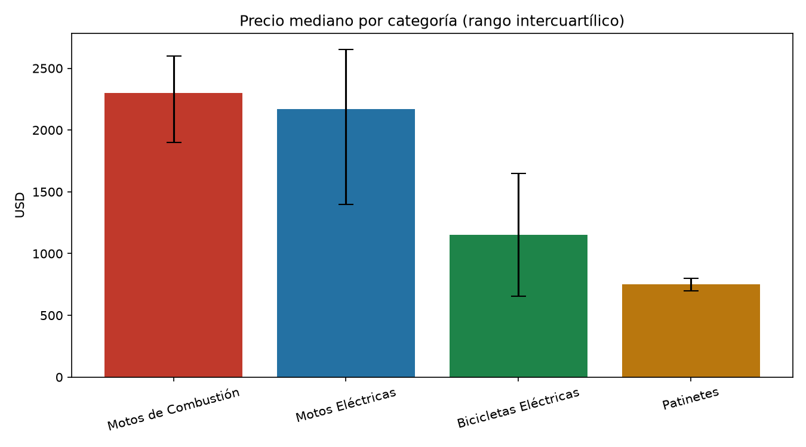
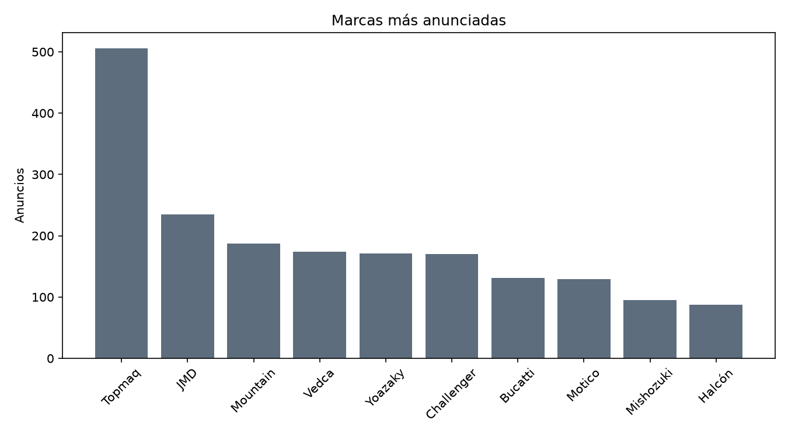
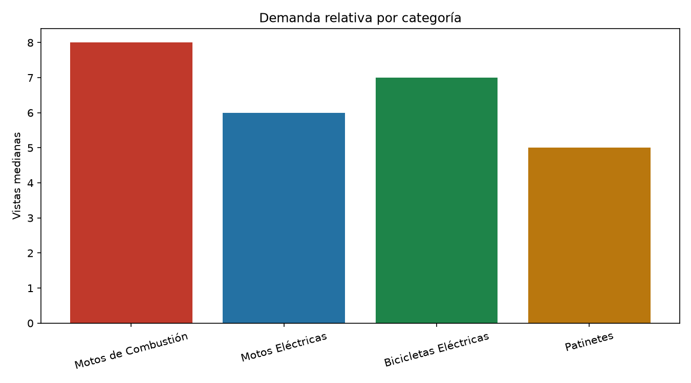

# La Habana sobre dos ruedas

## Storytelling del mercado de motos a partir de 6.101 anuncios y 30 entrevistas

**Proyecto:** Análisis del Mercado de Motos en La Habana (Introducción a la Ciencia de los Datos)
**Fuentes:** anuncios públicos de Revolico (La Habana, 10–26 de octubre de 2026) y 30 entrevistas cualitativas (25 compradores, 4 talleres y 1 importadora)
**Moneda:** USD, salvo que se indique lo contrario

> **Cómo leer este relato.** El dataset es una foto de 17 días de la **oferta publicada**, no de las ventas efectivas. Las entrevistas son una muestra pequeña y no probabilística. Por eso el relato distingue siempre entre **lo que muestran los datos**, **lo que dicen las personas** y **lo que todavía no podemos afirmar**. Las cifras cualitativas son declaraciones de los entrevistados, no mediciones verificadas.

---

## Prólogo: la ciudad que se mueve entre cargas

La Habana no se mueve solo en guaguas. Se mueve en motos que cruzan Diez de Octubre al amanecer, en bicicletas eléctricas que llevan un bulto de comida colgado del manubrio y en patinetes que aparecen y desaparecen entre el tráfico. En 17 días de octubre de 2026, Revolico publicó **6.101 anuncios** de venta de vehículos de dos ruedas en la ciudad. Si se suman las motos eléctricas y las bicicletas eléctricas, **7 de cada 10 anuncios son eléctricos** (78,3 %). La combustión, que durante décadas fue la norma, hoy representa **1 de cada 5** (18,0 %).

Ese es el primer hallazgo y también la primera trampa: lo que se publica no es necesariamente lo que se vende. Pero la composición de la oferta ya cuenta una historia. Detrás de cada anuncio hay alguien que decidió poner su vehículo en venta, y detrás de cada entrevista hay alguien que decidió contar cómo vive con él.

Este relato se arma con esas dos mitades: **el escaparate** (los anuncios) y **la vida cotidiana** (las entrevistas).

---

## Capítulo 1 — El escaparate: la electricidad ocupa la vitrina

### El dato

| Categoría | Anuncios | Peso sobre el total | Precio mediano (USD) |
|---|---:|---:|---:|
| Bicicletas eléctricas | 2.576 | 42,2 % | 1.150 |
| Motos eléctricas | 2.201 | 36,1 % | 2.050 |
| Motos de combustión | 1.099 | 18,0 % | 2.250 |
| Patinetes | 225 | 3,7 % | 750 |
| **Total** | **6.101** | **100 %** | — |

### La lectura

La movilidad eléctrica no es un nicho: es la mayoría de la oferta. Entre motos y bicicletas eléctricas suman **4.777 anuncios**, casi cuatro veces la oferta de combustión. La bicicleta eléctrica, además, es la categoría más numerosa y la más barata en mediana (**1.150 USD**), lo que la convierte en la puerta de entrada al mercado.

Pero hay un matiz importante: que haya más oferta eléctrica no significa que sea lo que más se vende. Puede significar que hay **más gente intentando vender** una eléctrica, o que el mercado de segunda mano eléctrico está más activo. Sin datos de ventas efectivas, esa distinción queda abierta.

> **Dato clave:** 78,3 % de los anuncios son eléctricos (motos + bicicletas), frente a 18,0 % de combustión.

---

## Capítulo 2 — ¿Cuánto cuesta moverse?

### El dato

| Categoría | Mediana | P25 | P75 | Mínimo | Máximo | Desviación |
|---|---:|---:|---:|---:|---:|---:|
| Motos de combustión | 2.250 | 1.900 | 2.592,5 | 111 | 4.500 | 595,0 |
| Motos eléctricas | 2.050 | 1.300 | 2.630 | 100 | 6.600 | 949,8 |
| Bicicletas eléctricas | 1.150 | 670 | 1.650 | 100 | 2.600 | 528,2 |
| Patinetes | 750 | 730 | 800 | 420 | 1.100 | 81,1 |

### La lectura

La mediana cuenta una historia de precios parecidos: una moto eléctrica típica (**2.050 USD**) es apenas un 9 % más barata que una de combustión (**2.250 USD**). La diferencia no está tanto en el precio de entrada como en **cómo se distribuye**.

La eléctrica tiene la mayor dispersión: su desviación es **949,8 USD**, frente a **595,0** en combustión. Eso significa que hay eléctricas muy baratas y eléctricas muy caras, y que el comprador necesita información para no pagar de más. La importadora lo dice con claridad: recomienda revisar la ficha técnica del modelo para evitar precios excesivos.

La bicicleta eléctrica y el patinete son otra liga: **1.150** y **750 USD** de mediana. Son las opciones de entrada, pero también las de menor autonomía y las más sensibles al uso.

> **Dato clave:** la mediana de la eléctrica es solo 200 USD menor que la de combustión, pero su dispersión es casi el doble.

---

## Capítulo 3 — Las marcas que se ven y las que no

### El dato

| Marca | Anuncios |
|---|---:|
| Topmaq | 506 |
| JMD | 227 |
| Mountain | 187 |
| Vedca | 173 |
| Challenger | 170 |
| Yoazaky | 165 |
| Bucatti | 131 |
| Motico | 129 |
| Mishozuki | 95 |
| Halcón | 87 |

### La lectura

**Topmaq** domina el escaparate con **506 anuncios**, seguida de lejos por JMD (227) y Mountain (187). En motos eléctricas lidera Topmaq (303), seguida de Vedca (110) y Mountain (101). En combustión aparecen Italy (64), Katzu (60) y Krathos (54). En bicicletas eléctricas mandan JMD (178), Topmaq (162) y Yoazaky (157).

Pero el dato más honesto es el que falta: **2.910 de los 6.101 anuncios (47,7 %)** no declaran marca. Casi la mitad del mercado es una categoría heterogénea de productos sin marca o con marca no identificada. Eso explica por qué el ranking de marcas no puede leerse como ranking de ventas: es un ranking de **lo que se publica con nombre**.

> **Dato clave:** casi la mitad de la oferta (47,7 %) no declara marca; el ranking refleja visibilidad, no necesariamente preferencia.

---

## Capítulo 4 — La paradoja de las miradas

### El dato

| Categoría | Vistas totales | Vistas medianas | Vistas promedio |
|---|---:|---:|---:|
| Motos de combustión | 68.569 | 8 | 62,4 |
| Bicicletas eléctricas | 67.828 | 7 | 26,3 |
| Motos eléctricas | 33.454 | 6 | 15,2 |
| Patinetes | 1.904 | 5 | 8,5 |

### La lectura

Aquí aparece una tensión interesante. La combustión tiene **menos anuncios** (1.099) pero el **mayor promedio de vistas** (62,4), muy por encima de la eléctrica (15,2). La mediana, en cambio, es parecida (8 frente a 6). La diferencia entre mediana y promedio indica que unos pocos anuncios de combustión concentran muchas miradas: probablemente motos llamativas, bien presentadas o con precios competitivos.

Las bicicletas eléctricas acumulan **67.828 vistas**, casi las mismas que la combustión, pero repartidas entre 2.576 anuncios. Es decir: mucha oferta y atención dispersa.

> **Advertencia:** las vistas son un **proxy de interés**, no de demanda real. Un anuncio puede tener muchas vistas y no venderse, o venderse rápido con pocas.

---

## Capítulo 5 — La vida detrás de los anuncios

Las entrevistas cambian el tono del relato. Ya no se trata de categorías y medianas, sino de personas que cargan, trabajan, esperan y se arreglan con lo que hay. De los 25 compradores entrevistados, **8 declaran uso exclusivo de trabajo**, 3 un uso mixto (trabajo/recados) y 2 mensajería o reparto. Solo 2 declaran uso personal. La moto, para la mayoría, no es un juguete: es una herramienta de ingreso.

### El diseñador de luces que carga dos veces al día

`COMPRADOR_025` tiene 40 años, es diseñador de luces y vive en Plaza de la Revolución (Vedado). Compró una eléctrica a un conocido por **1.000 USD**. La usa para trabajar y para resolver el día a día. Carga todos los días y, a veces, **hasta dos veces al día**. Los apagones le impiden usarla en ocasiones. No tiene chapa ni licencia y ha tenido problemas en la estación. La autonomía que le prometieron era real, pero ha ido disminuyendo. Hoy, dice, elegiría una moto de combustión por practicidad y seguridad, aunque la gasolina suba.

> **Lo que muestra:** el costo de carga bajo no compensa del todo la dependencia eléctrica cuando la red falla y los papeles no están en regla.

### El trabajador de 60 años que compró combustión nueva en Panamá

`COMPRADOR_012` compró una moto de combustión de cuatro tiempos **nueva (cero kilómetro)** a través de una importadora de Panamá, con entrega en su casa. Recibe remesas casi todos los meses y contó con ayuda familiar. Destina el **80 % del uso al trabajo**; recorre **28–35 km al día** y gasta aproximadamente **1 litro de combustible diario**. Consideró una eléctrica, pero no pudo; cambiaría a eléctrica por eficiencia y ahorro, y menciona **120–130 km** de autonomía.

> **Lo que muestra:** la preferencia declarada no siempre coincide con la compra. El precio, la disponibilidad y la ayuda familiar pesan más que la tecnología deseada.

### El dueño de 11 años y tres baterías

`COMPRADOR_017` tiene una eléctrica importada desde Panamá por unos **1.640 USD**. Lleva **11 años** con ella y va por la **tercera batería**; la última le costó unos **900 USD**. Menciona unos **75 km** de autonomía. Dice que las piezas se consiguen con tiempo y que prefiere comprar nuevo antes que arriesgarse con lo usado.

> **Lo que muestra:** la eléctrica puede durar, pero el costo de la batería domina el costo total de propiedad. La segunda compra no es la moto: es la batería.

### El mensajero que anuncia 100 y obtiene 60

`COMPRADOR_014` compró una eléctrica a un particular. El vendedor prometía **80–100 km** de autonomía; en la práctica obtiene unos **50–69 km**. La usa para mensajería, recados y traslados familiares. Los apagones afectan la carga y a veces carga donde un vecino.

> **Lo que muestra:** la brecha entre autonomía prometida y real es un dato recurrente, y depende del peso, la velocidad y el terreno.

### La enfermera/o de Diez de Octubre

`COMPRADOR_018` tiene 34 años, trabaja como enfermero/a y se entiende que vive en Diez de Octubre (por confirmar). Compró una moto de combustión usada por Revolico, le pareció cara, y en dos años ha tenido problemas con piezas, aceite y neumático.

> **Lo que muestra:** la combustión usada sigue siendo una opción para quien prioriza rendimiento y kilometraje, pero el mantenimiento correctivo forma parte del presupuesto.

---

## Capítulo 6 — La batería como segunda compra

### El dato

- **284 anuncios** mencionan “batería” y **139** mencionan “litio”: es un atributo central de la oferta.
- **242 anuncios** mencionan “autonomía”, pero es información declarada por el vendedor, no medida.
- **74** mencionan “carga” y **33** “cargador”, como atributos del producto, no como práctica del usuario.

### La lectura

En las entrevistas, la batería deja de ser una característica y se convierte en un gasto. Una batería de mayor capacidad se compró por **800 USD** (`COMPRADOR_009`); la tercera batería de una eléctrica de 11 años costó unos **900 USD** (`COMPRADOR_017`). Para una moto que se compró por 1.000 USD, cambiar la batería puede costar casi lo mismo que el vehículo.

La autonomía, además, es una promesa que se desgasta. `COMPRADOR_014` reporta 50–69 km reales frente a 80–100 anunciados. `COMPRADOR_020` y `COMPRADOR_025` dicen que la autonomía ha disminuido con el tiempo. `COMPRADOR_023`, en cambio, percibe que ha aumentado. `TALLER_004` aporta el matiz técnico: la autonomía varía según el peso, la velocidad y las lomas.

> **Dato clave:** el costo de reemplazo de batería reportado (800–900 USD) puede equivaler a la mayor parte del precio de una bicicleta eléctrica o de una moto usada.

---

## Capítulo 7 — Papeles, aduana y el precio invisible

### El dato

- **6.064 de 6.101 anuncios (99,4 %)** están en USD; solo 37 están en CUP y quedan fuera de las estadísticas de precio.
- **47 anuncios** mencionan “papeles” y **60** mencionan “chapa”; ninguno menciona “licencia”.
- **69 anuncios** mencionan “garantía”.

### La lectura

El mercado se cotiza prácticamente en dólares. Eso no es un detalle: significa que el precio de una moto está atado a una moneda que la mayoría de los compradores no gana en su salario habitual. Las remesas, la ayuda familiar y el ahorro en divisa entran en la decisión, aunque el proyecto solo tenga un caso con dato utilizable.

La formalidad es un mosaico. `COMPRADOR_010`, `COMPRADOR_016` y `COMPRADOR_025` declaran **no tener chapa ni licencia**. `COMPRADOR_009` y `COMPRADOR_013` sí tienen licencia; `COMPRADOR_009` además tiene chapa. `COMPRADOR_012` compró por importadora y percibe el mercado como legal. No hay base para estimar proporciones, pero sí para afirmar que **prácticas formales e informales conviven**.

La voz de la oferta formal es Solimport (`IMPORTADORA_001`). Describe la cadena de importación: proveedor en el exterior, transporte, nacionalización, aranceles, impuesto sobre ventas y margen comercial. Menciona una **rebaja de aranceles** y una carga del **5 %**, pero la transcripción es ruidosa y el propio registro lo deja en `preguntas_pendientes`. También señala que el precio de reventa puede estar **1.000–2.000 USD o más por encima del oficial**.

> **Advertencia:** las cifras de aranceles (5 % para eléctricas, 20 % para combustión) son **declaraciones por confirmar**, no datos oficiales verificados.

---

## Capítulo 8 — El taller que no conocemos

Hay cuatro entrevistas de talleres (`TALLER_001` a `TALLER_004`), pero su identidad como talleres **no está confirmada**: la asignación viene de la carpeta de origen y el contenido no siempre lo corrobora. Aun así, aportan pistas:

- `TALLER_001` prefiere gasolina y gasóleo, y dice que la autonomía prometida por los vendedores ha disminuido.
- `TALLER_002` habla de autonomía, batería y garantía, pero sin datos inteligibles.
- `TALLER_003` usa una eléctrica para el trabajo; el audio es muy corto.
- `TALLER_004` aporta el matiz más útil: la autonomía varía según el peso, la velocidad y las lomas.

En los anuncios, el tema de los repuestos casi no aparece: **0 menciones a “repuesto”**. En las entrevistas, en cambio, sí: `COMPRADOR_018` menciona piezas, aceite y neumático; `COMPRADOR_025`, el puño de acelerar y los plásticos; `COMPRADOR_017` dice que las piezas se consiguen con tiempo; `COMPRADOR_019` tuvo que mandar a arreglar una pieza; `COMPRADOR_024` sufrió el robo o daño de una pieza.

> **Lo que falta:** no hay un censo de talleres, ni tiempos de reparación, ni precios sistemáticos de repuestos. La fuente de talleres es la más débil del proyecto y debe confirmarse en campo.

---

## Capítulo 9 — Dos futuros posibles

El proyecto no tiene serie temporal suficiente para pronosticar. Lo que sí puede hacer es plantear **escenarios cualitativos** con la evidencia disponible.

### Escenario A: la eléctrica se consolida

Ocurriría si se resuelven tres cuellos de botella: **carga** (apagones y acceso a la red), **batería** (costo y vida útil) y **papeles** (chapa, licencia, registro). La oferta ya es mayoritariamente eléctrica (78,3 %), la importadora percibe un avance de lo eléctrico y varios compradores usan la moto para trabajar. Si el costo de operación sigue siendo bajo y la red mejora, la eléctrica podría consolidarse como la opción principal de movilidad urbana.

### Escenario B: la combustión resiste

Ocurriría si el combustible se mantiene disponible y si la eléctrica no resuelve la autonomía ni la informalidad. `COMPRADOR_025` dice que hoy elegiría combustión por practicidad y seguridad. `COMPRADOR_012` compró combustión nueva importada y solo cambiaría a eléctrica si pudiera. `COMPRADOR_019` prefiere gasolina por rendimiento y kilometraje. Los talleres entrevistados, aunque con identidad por confirmar, se inclinan por gasolina.

### Lo más probable: convivencia

La evidencia apunta a una **convivencia situacional**: eléctrica para trayectos cortos y trabajo urbano; combustión para viajes largos, carga pesada o cuando la red falla. `COMPRADOR_013` lo resume con una lógica híbrida: gasolina para viajes largos y trabajo, eléctrica como respaldo cuando no hay electricidad.

> **Dato clave:** la decisión de compra no es ideológica ni puramente tecnológica; es **situacional**. Pesan la distancia, la disponibilidad de electricidad, el precio, la batería y los papeles.

---

## Epílogo: lo que esta historia no puede decir

Un buen storytelling también se define por lo que no afirma. Este proyecto **no puede**:

1. Medir **crecimiento** del mercado: solo hay 17 días de datos y tres cortes pequeños.
2. Distinguir **ventas efectivas** de oferta publicada.
3. Comparar **zonas de La Habana**: el dataset solo registra “La Habana”, sin municipio.
4. Separar **motos nuevas de usadas**: solo 323 anuncios usan la palabra “nueva” y ninguno dice “usada”.
5. Estimar la influencia de las **remesas**: solo 1 de 25 compradores dio un dato utilizable.
6. Confirmar **aranceles y regulaciones** con fuente oficial.
7. Generalizar sobre **talleres**: 4 entrevistas, identidad no confirmada.
8. Construir un **ranking de repuestos**: no hay módulo específico de piezas, tiempos y precios.
9. Convertir **CUP a USD**: los 37 anuncios en CUP quedan fuera de las estadísticas de precio.

Estas ausencias no invalidan el relato: lo delimitan. La historia que sí se puede contar es la de un mercado **eléctrico en la vitrina, laboral en el uso, informal en los papeles y frágil en la energía**.

---

## Anexo 1 — Cifras que sostienen el relato

| Indicador | Valor | Fuente |
|---|---:|---|
| Anuncios analizados | 6.101 | `data/processed/anuncios_limpios.csv` |
| Periodo | 10–26 oct. 2026 | `data/raw/revolico/` |
| Motos eléctricas | 2.201 (36,1 %) | `reports/metricas/resumen_mercado.json` |
| Bicicletas eléctricas | 2.576 (42,2 %) | ídem |
| Motos de combustión | 1.099 (18,0 %) | ídem |
| Patinetes | 225 (3,7 %) | ídem |
| Oferta eléctrica total | 4.777 (78,3 %) | cálculo sobre el total |
| Mediana combustión | 2.250 USD | ídem |
| Mediana eléctrica | 2.050 USD | ídem |
| Mediana bicicleta eléctrica | 1.150 USD | ídem |
| Mediana patinete | 750 USD | ídem |
| Anuncios en USD | 6.064 (99,4 %) | ídem |
| Anuncios sin marca | 2.910 (47,7 %) | ídem |
| Entrevistas | 30 (25 + 4 + 1) | `docs/entrevistas/*.json` |
| Uso laboral exclusivo | 8 de 25 compradores | `docs/entrevistas/analisis_lote_2026-11-05.md` |
| Batería reportada | 800–900 USD | `COMPRADOR_009`, `COMPRADOR_017` |

## Anexo 2 — Personajes del relato

| Personaje | Entrevista | Dato que lo define |
|---|---|---|
| Diseñador de luces, 40 años, Vedado | `COMPRADOR_025` | Eléctrica de 1.000 USD; carga diaria; sin chapa ni licencia; hoy elegiría combustión |
| Trabajador de 60 años | `COMPRADOR_012` | Combustión nueva importada por Panamá; 80 % uso trabajo; 1 litro diario |
| Dueño de 11 años | `COMPRADOR_017` | Eléctrica importada por 1.640 USD; tercera batería de 900 USD |
| Mensajero | `COMPRADOR_014` | Autonomía prometida 80–100 km; real 50–69 km; carga donde un vecino |
| Enfermero/a de Diez de Octubre | `COMPRADOR_018` | Combustión usada por Revolico; piezas, aceite y neumático |
| Voz de la oferta formal | `IMPORTADORA_001` | Importación, aranceles por confirmar, reventa 1.000–2.000 USD sobre el precio oficial |

## Anexo 3 — Guion breve para presentar

1. **Abrir con la ciudad:** “La Habana se mueve en dos ruedas; en 17 días se publicaron 6.101 anuncios”.
2. **Mostrar la vitrina:** 78,3 % de la oferta es eléctrica; la bicicleta eléctrica es la más numerosa y la más barata.
3. **Bajar a los precios:** medianas parecidas entre combustión y eléctrica, pero la eléctrica tiene el doble de dispersión.
4. **Contar una vida:** el diseñador de luces que carga dos veces al día, o el dueño de 11 años y tres baterías.
5. **Señalar el costo oculto:** la batería (800–900 USD) y la autonomía que se desgasta.
6. **Mostrar la tensión:** más oferta eléctrica, pero más promedio de vistas en combustión.
7. **Cerrar con el límite y el futuro:** no podemos pronosticar; podemos decir que la decisión es situacional y que la eléctrica se consolidará si mejora la carga, la batería y los papeles.

---

*Documento de storytelling elaborado a partir de `reports/informe_mercado.md`, `reports/metricas/resumen_mercado.json`, `docs/entrevistas/*.json` y `docs/entrevistas/analisis_lote_2026-11-05.md`. No se añadieron datos que no estuvieran en las fuentes del proyecto.*
