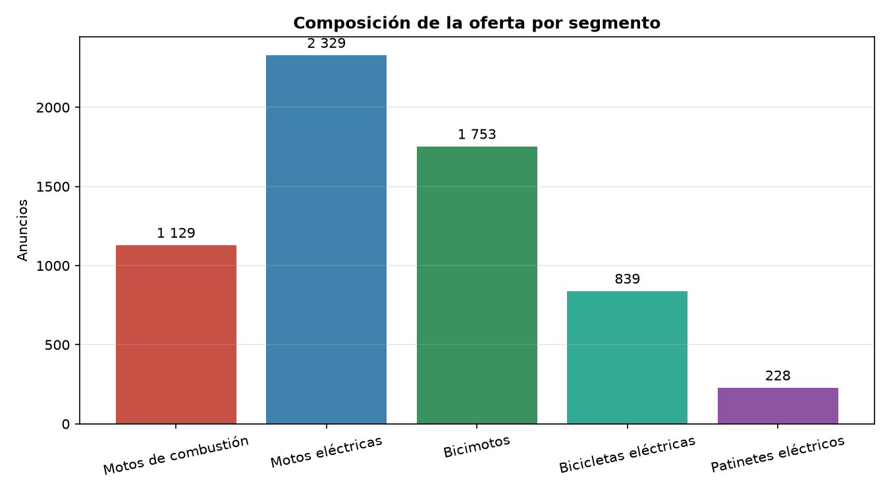
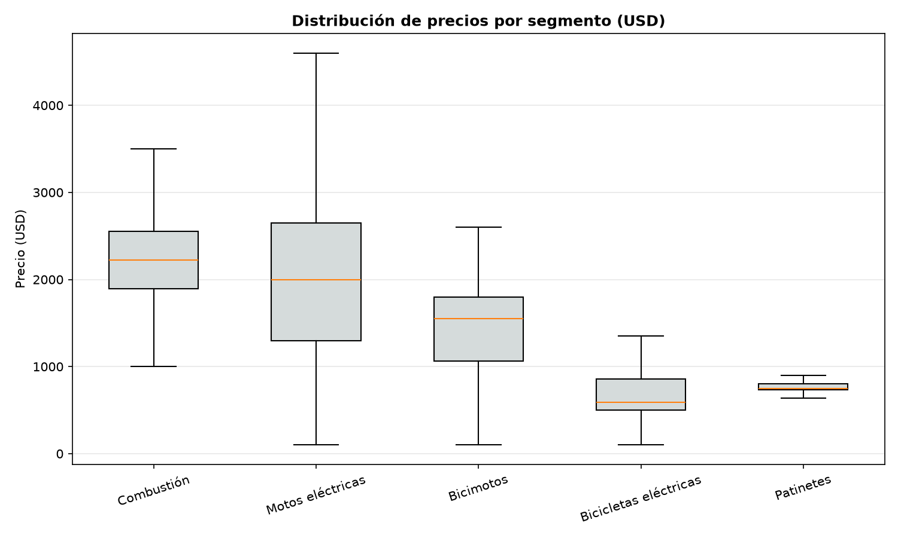
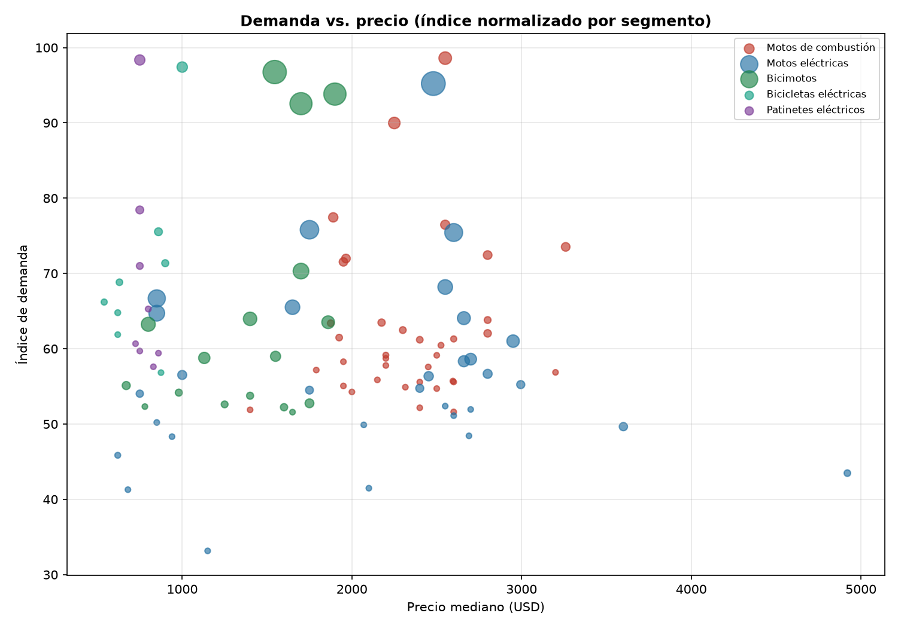

# Informe de Mercado — Motos y Movilidad Eléctrica en La Habana

> **Corte:** 2026-10-26 · **Fuente principal:** Revolico (La Habana) · **Anuncios analizados:** 6 278 · **Precios válidos en USD:** 5 714

> **Nota de alcance:** este informe se construyó exclusivamente con datos observados. La fuente Telegram está pendiente de credenciales (API oficial), por lo que no se incluyen anuncios de ese canal ni se estiman cifras no medidas.

## 1. Resumen Ejecutivo

Se partió de **6 643 registros brutos** de 3 cortes de Revolico (17, 22 y 26 de octubre de 2026). Tras excluir no-vehículos y duplicados quedaron **6 278 anuncios únicos**; el **91,0 %** tiene precio válido en USD. La cobertura de marca identificada es del **48,2 %**.

- **Combustión:** el modelo con mayor índice de demanda es **ITALY RX Combat** (51 anuncios, mediana 2 550 USD). El segmento de 150 cc (todas las marcas) suma 211 anuncios, mediana 1 950 USD; de ellos, 95 no especifican marca.
- **Eléctricas:** **TOPMAQ General** lidera (182 anuncios, mediana 2 480 USD). TOPMAQ, VEDCA y MOUNTAIN concentran la mayor oferta del segmento.
- **Bicimotos:** **JMD General** es la más ofertada (175 anuncios, mediana 1 545 USD).
- **Patinetes:** **JMD General** lidera (34 anuncios, mediana 750 USD).
- **Hallazgo clave:** el mercado es **eficiente en precio**: el diferencial entre compra (P25) y venta (mediana) es estrecho y, con un costo operativo del 10 %, no cubre el arbitraje local en la mayoría de los modelos. La rentabilidad aparece al **comprar en el decil bajo (P10)** o al **importar**.
- **Hipótesis no confirmadas:** Yadea y Yati **no aparecen** en la muestra (0 y 1 anuncio respectivamente). La GN125 existe, pero no es la más ofertada: RX Combat la supera en volumen. La hipótesis de precio de la GN125 (1 500–1 800 USD) no se sostiene: la mediana observada es superior.

## 2. Metodología

**Fuentes y ventana.** Se usaron 3 cortes reales de Revolico La Habana (17, 22 y 26 de octubre de 2026; 6 193 anuncios del 17 de octubre, 43 anuncios del 22 de octubre y 42 anuncios del 26 de octubre). La ventana efectiva es de 17 días. Telegram queda fuera por falta de credenciales; no se imputaron datos.

**ETL.** 1) Lectura de los JSON crudos sin modificarlos. 2) Clasificación en combustión, moto eléctrica, bicimoto, bicicleta eléctrica y patinete. 3) Exclusión de triciclos, motocarros, mototaxis, cuatrimotos, repuestos y accesorios. 4) Normalización de marcas y modelos (GN125/GN-125/GN 125 → Suzuki GN125; AX100/AX-100 → Suzuki AX100, etc.). 5) Deduplicación por ID y por reposts exactos. 6) Precios numéricos; se excluyen del cálculo los menores de 100 USD y los atípicos extremos (3 × IQR por segmento).

**Rankings.** Las tablas A–D se ordenan por el índice de demanda, no solo por número de anuncios; por eso un modelo con más anuncios puede aparecer debajo de otro con mejor combinación de estabilidad y velocidad.

**Índice de demanda.** 40 % frecuencia relativa dentro del segmento, 30 % presencia en fuentes, 20 % estabilidad de precios (1 − CV) y 10 % velocidad de publicación (anuncios/día). Cada componente se normaliza 0–1. Con una sola fuente, el componente de fuentes vale 1 para todos y **no diferencia**; se activará cuando se incorpore Telegram. En una ventana fija, anuncios/día es proporcional al volumen, por lo que la velocidad está correlacionada con la frecuencia. Los modelos con un único precio observado (CV = 0) reciben la máxima estabilidad; por eso el índice debe leerse junto con el número de anuncios.

**Limitaciones.** Los precios son **precios de anuncio**, no de transacción. No hay datos de ventas cerradas ni de tiempo hasta la venta. La muestra es un corte transversal de 17 días y la marca no se especifica en una parte de los anuncios. Los resultados describen la **oferta activa**, no el volumen histórico de ventas.

## 3. Datos Analizados

- Registros brutos: **6 643**
- Excluidos por no ser vehículos de la lista blanca: **140**
- Duplicados eliminados: **225** (ID: 74, reposts: 151)
- Registros limpios: **6 278**
- Con precio válido en USD: **5 714**
- Moneda distinta de USD (excluida de precios): **38** anuncios en CUP
- Anuncios sin marca identificada: **3 252** (51,8 %)

| Segmento | Anuncios | % del total |
|---|---:|---:|
| Motos de combustión | 1 129 | 18,0 % |
| Motos eléctricas | 2 329 | 37,1 % |
| Bicimotos | 1 753 | 27,9 % |
| Bicicletas eléctricas | 839 | 13,4 % |
| Patinetes eléctricos | 228 | 3,6 % |

## 4. Moto de Combustión Más Demandada

**ITALY RX Combat** encabeza el índice de demanda del segmento con **51 anuncios** (8,4 % de los anuncios de combustión con marca identificada), precio promedio **2 536 USD**, mediana **2 550 USD** y rango **1 950–3 040 USD**. Su coeficiente de variación es **0,07**, lo que indica un precio bastante estable.

**Contraste con las hipótesis iniciales.** La GN125 no lidera el volumen: la familia GN125 reúne 21 anuncios, mientras RX Combat suma 51. La GN125 conserva, sin embargo, un **premio de marca** y un diferencial P10–P75 más amplio, lo que la hace más atractiva para reventa que para rotación.

El segmento de **150 cc sin marca** reúne 95 anuncios (mediana 1 984 USD) y es el bloque más numeroso de la combustión: marca el precio de entrada del mercado y compite directamente con las eléctricas de gama media.

### Tabla A — Top motos de combustión

| Ranking | Marca | Modelo | Anuncios | % Mercado | Precio Promedio | Precio Mínimo | Precio Máximo |
|---:|---|---|---:|---:|---:|---:|---:|
| 1 | ITALY | RX Combat | 51 | 8,4 % | 2 536 | 1 950 | 3 040 |
| 2 | KATZU | General | 43 | 7,1 % | 2 277 | 1 800 | 2 700 |
| 3 | JIN | 150cc | 28 | 4,6 % | 1 890 | 1 890 | 1 890 |
| 4 | KRATHOS | 200cc | 27 | 4,5 % | 2 550 | 2 550 | 2 550 |
| 5 | KRATHOS | 250cc | 24 | 4,0 % | 3 260 | 3 260 | 3 260 |
| 6 | UNISON | General | 24 | 4,0 % | 2 742 | 2 500 | 3 000 |
| 7 | WYS | 150cc | 24 | 4,0 % | 2 027 | 1 750 | 2 400 |
| 8 | MOTORSTRECK | General | 23 | 3,8 % | 1 965 | 1 850 | 2 300 |
| 9 | UNISON | 200cc | 15 | 2,5 % | 2 807 | 2 500 | 3 000 |
| 10 | TOPMAQ | General | 17 | 2,8 % | 2 151 | 1 400 | 2 520 |

> % de mercado calculado sobre anuncios **con marca identificada** del segmento. El segmento genérico de 150 cc (sin marca) se analiza por separado en el texto.

## 5. Moto Eléctrica Más Demandada

**TOPMAQ General** es la moto eléctrica más demandada: **182 anuncios** (15,1 % del segmento con marca identificada), promedio **2 471 USD**, mediana **2 480 USD**, rango **800–5 300 USD**. Le siguen VEDCA, MOUNTAIN y CHALLENGER.

**Hipótesis vs. datos.** Yadea y Yati no tienen presencia relevante en la muestra (0 y 1 anuncio). El liderazgo real corresponde a **TOPMAQ**, con una familia amplia de modelos (TANK, F3 y versiones generales). JMD no lidera las motos eléctricas: su fortaleza está en **bicimotos y patinetes**.

### Tabla B — Top motos eléctricas

| Ranking | Marca | Modelo | Anuncios | % Mercado | Precio Promedio | Precio Mínimo | Precio Máximo |
|---:|---|---|---:|---:|---:|---:|---:|
| 1 | TOPMAQ | General | 182 | 15,1 % | 2 471 | 800 | 5 300 |
| 2 | VEDCA | General | 110 | 9,2 % | 1 920 | 1 099 | 2 750 |
| 3 | MOUNTAIN | General | 103 | 8,6 % | 2 653 | 1 600 | 3 300 |
| 4 | TOPMAQ | TANK | 69 | 5,7 % | 2 552 | 2 350 | 3 000 |
| 5 | CHALLENGER | General | 95 | 7,9 % | 1 094 | 700 | 2 800 |
| 6 | KVITOVA | General | 68 | 5,7 % | 1 640 | 1 390 | 3 490 |
| 7 | MOTICO | General | 80 | 6,7 % | 986 | 400 | 1 950 |
| 8 | TOPMAQ | F3 | 54 | 4,5 % | 2 663 | 2 200 | 2 850 |
| 9 | YOAZAKY | General | 50 | 4,2 % | 2 784 | 1 800 | 3 100 |
| 10 | BUCATTI | General | 44 | 3,7 % | 2 555 | 1 050 | 3 200 |

## 6. Bicimoto Más Demandada

**JMD General** lidera las bicimotos con **175 anuncios** (18,2 % del segmento con marca identificada), promedio **1 479 USD**, mediana **1 545 USD** y rango **630–1 850 USD**. TOPMAQ y YOAZAKY le siguen muy de cerca.

El segmento de bicimotos es el **segundo más numeroso** de la muestra y el de menor ticket entre las motos (1 424 USD de promedio), por debajo de combustión y eléctricas, aunque por encima de bicicletas y patinetes. Es la puerta de entrada natural para un negocio con capital limitado; la contrapartida es un margen absoluto pequeño por unidad.

### Tabla C — Top bicimotos

| Ranking | Marca | Modelo | Anuncios | % Mercado | Precio Promedio | Precio Mínimo | Precio Máximo |
|---:|---|---|---:|---:|---:|---:|---:|
| 1 | JMD | General | 175 | 18,2 % | 1 479 | 630 | 1 850 |
| 2 | TOPMAQ | General | 159 | 16,5 % | 1 895 | 850 | 2 600 |
| 3 | YOAZAKY | General | 157 | 16,3 % | 1 724 | 1 050 | 2 120 |
| 4 | MOUNTAIN | General | 79 | 8,2 % | 1 701 | 160 | 1 920 |
| 5 | VEDCA | General | 58 | 6,0 % | 1 371 | 650 | 1 660 |
| 6 | MISHOZUKI | General | 52 | 5,4 % | 1 860 | 1 500 | 2 100 |
| 7 | CHALLENGER | General | 63 | 6,5 % | 874 | 630 | 1 550 |
| 8 | MATECH | General | 33 | 3,4 % | 1 535 | 1 470 | 1 600 |
| 9 | MAF | General | 41 | 4,3 % | 1 084 | 680 | 1 350 |
| 10 | LAITUNING | General | 21 | 2,2 % | 672 | 640 | 750 |

## 7. Patinete Más Demandado

**JMD General** es el patinete más ofertado (34 anuncios, mediana 750 USD, rango 650–1 000 USD). MAF, PROEFIX y MRK completan un mercado muy concentrado en torno a los 750–860 USD.

El patinete es un segmento **commoditizado**: precios muy estables y productos poco diferenciados. La oportunidad no está en el margen por unidad sino en el volumen y en la venta de accesorios/servicio.

### Tabla D — Top patinetes

| Ranking | Marca | Modelo | Anuncios | % Mercado | Precio Promedio | Precio Mínimo | Precio Máximo |
|---:|---|---|---:|---:|---:|---:|---:|
| 1 | JMD | General | 34 | 28,8 % | 744 | 650 | 1 000 |
| 2 | MAF | General | 20 | 16,9 % | 734 | 650 | 800 |
| 3 | PROEFIX | General | 15 | 12,7 % | 742 | 700 | 800 |
| 4 | MRK | General | 11 | 9,3 % | 810 | 760 | 890 |
| 5 | LAITUNING | General | 8 | 6,8 % | 715 | 640 | 750 |
| 6 | LAZER | General | 7 | 5,9 % | 757 | 720 | 800 |
| 7 | MIDHA | General | 7 | 5,9 % | 861 | 800 | 900 |
| 8 | CHALLENGER | General | 7 | 5,9 % | 841 | 750 | 1 100 |

## 8. Análisis de Precios

| Segmento | Anuncios | Con precio USD | Promedio | Mediana | Mínimo | Máximo | Desv. estándar | CV |
|---|---:|---:|---:|---:|---:|---:|---:|---:|
| Motos de combustión | 1 129 | 1 005 | 2 184 | 2 220 | 111 | 4 500 | 628 | 0,29 |
| Motos eléctricas | 2 329 | 2 079 | 1 972 | 2 000 | 100 | 6 600 | 996 | 0,51 |
| Bicimotos | 1 753 | 1 629 | 1 425 | 1 550 | 100 | 2 600 | 457 | 0,32 |
| Bicicletas eléctricas | 839 | 803 | 689 | 590 | 100 | 1 920 | 236 | 0,34 |
| Patinetes eléctricos | 228 | 198 | 765 | 750 | 420 | 1 100 | 81 | 0,11 |

**Lectura.** La mediana de las motos de combustión (**2 220 USD**) es superior a la de las eléctricas (**2 000 USD**) y muy superior a la de bicimotos (**1 550 USD**), bicicletas eléctricas (**590 USD**) y patinetes (**750 USD**). La dispersión es mayor en eléctricas (CV 0,51) que en combustión (CV 0,29) debido a la convivencia de modelos de entrada y de gama alta.

## 9. Análisis de Rentabilidad

Se modelaron dos escenarios con **costos operativos del 10 %** sobre el precio de venta (transporte, reparaciones menores, negociación):

- **Base:** compra en P25 y venta en la mediana.
- **Oportunista:** compra en P10 y venta en P75 (requiere comprar bien y esperar).

| Segmento | Modelo | Compra P25 | Venta mediana | Margen neto/unidad | ROI |
|---|---|---:|---:|---:|---:|
| Motos de combustión | ITALY RX Combat | 2 490 | 2 550 | -195 | -7,8 % |
| Motos de combustión | SUZUKI GN125 | 2 000 | 2 400 | 160 | 8,0 % |
| Motos eléctricas | TOPMAQ General | 2 187 | 2 480 | 45 | 2,1 % |
| Bicimotos | JMD General | 1 468 | 1 545 | -77 | -5,2 % |
| Patinetes eléctricos | JMD General | 700 | 750 | -25 | -3,6 % |

**Conclusión de rentabilidad.** En el escenario base, la mayoría de los modelos queda en margen cero o negativo: el mercado descuenta muy rápido la información. La ganancia aparece en el escenario oportunista, sobre todo en **TOPMAQ** y **GN125**. Las bicimotos y patinetes, con diferenciales P10–P75 de 70–190 USD, no cubren un costo operativo del 10 % salvo que se compre por debajo del P10.

### Escenarios de capital (compra P10 → venta P75)

| Capital | Segmento | Modelo | Compra (P10) | Venta (P75) | Unidades | Inversión | Utilidad neta | ROI |
|---:|---|---|---:|---:|---:|---:|---:|---:|
| 5 000 | Motos de combustión | ITALY RX Combat | 2 400 | 2 600 | 2 | 4 800 | -120 | -2,5 % |
| 5 000 | Motos de combustión | SUZUKI GN125 | 1 750 | 2 400 | 2 | 3 500 | 820 | 23,4 % |
| 5 000 | Motos eléctricas | TOPMAQ General | 1 865 | 2 650 | 2 | 3 730 | 1 040 | 27,9 % |
| 5 000 | Bicimotos | JMD General | 1 382 | 1 565 | 3 | 4 146 | 80 | 1,9 % |
| 5 000 | Patinetes eléctricos | JMD General | 680 | 750 | 7 | 4 760 | -35 | -0,7 % |
| 10 000 | Motos de combustión | ITALY RX Combat | 2 400 | 2 600 | 4 | 9 600 | -240 | -2,5 % |
| 10 000 | Motos de combustión | SUZUKI GN125 | 1 750 | 2 400 | 5 | 8 750 | 2 050 | 23,4 % |
| 10 000 | Motos eléctricas | TOPMAQ General | 1 865 | 2 650 | 5 | 9 325 | 2 600 | 27,9 % |
| 10 000 | Bicimotos | JMD General | 1 382 | 1 565 | 7 | 9 674 | 186 | 1,9 % |
| 10 000 | Patinetes eléctricos | JMD General | 680 | 750 | 14 | 9 520 | -70 | -0,7 % |
| 20 000 | Motos de combustión | ITALY RX Combat | 2 400 | 2 600 | 8 | 19 200 | -480 | -2,5 % |
| 20 000 | Motos de combustión | SUZUKI GN125 | 1 750 | 2 400 | 11 | 19 250 | 4 510 | 23,4 % |
| 20 000 | Motos eléctricas | TOPMAQ General | 1 865 | 2 650 | 10 | 18 650 | 5 200 | 27,9 % |
| 20 000 | Bicimotos | JMD General | 1 382 | 1 565 | 14 | 19 348 | 371 | 1,9 % |
| 20 000 | Patinetes eléctricos | JMD General | 680 | 750 | 29 | 19 720 | -145 | -0,7 % |

> La inversión mostrada es el capital efectivamente utilizado; el resto queda como colchón. La utilidad es neta de costos operativos estimados. No incluye impuestos, permisos ni capital de trabajo adicional.

## 10. Recomendaciones de Inversión

1. **Núcleo de cartera: TOPMAQ (eléctricas).** Mayor volumen, marca reconocida y el mejor ROI oportunista del estudio. Priorizar TANK y F3, que tienen precios más definidos que la categoría “General”.
2. **Nicho de margen: Suzuki GN125.** Menos oferta que RX Combat, pero mayor diferencial P10–P75 y premio de marca. Comprar unidades 2019–2023 en buen estado y vender a coleccionistas/uso diario.
3. **Rotación rápida: JMD bicimotos.** Ticket bajo (1 550 USD), volumen alto y demanda constante. Sirve para generar flujo de caja, no para margen.
4. **Evitar arbitraje puro en RX Combat.** Es la más líquida, pero su spread P25–mediana es de solo ~70 USD y no cubre costos. Usarla para servicio, personalización o importación por volumen.
5. **Patinetes: volumen y accesorios.** El margen por unidad es mínimo; la rentabilidad está en la venta cruzada (cascos, baterías, repuestos) y en el servicio técnico.

**Asignación sugerida por capital:**

- **5 000 USD:** 2 GN125 o 2 TOPMAQ (una sola línea) + colchón para reparaciones.
- **10 000 USD:** 4–5 unidades mixtas (2 TOPMAQ, 2 GN125, 1 JMD) para diversificar.
- **20 000 USD:** lote de importación de 8–10 eléctricas + 3–4 GN125; negociar flete y consolidar un taller de preparación.

## 11. Riesgos del Mercado

- **Muestra de una sola fuente.** Revolico concentra la oferta formal, pero no cubre la venta informal ni los grupos de Telegram (pendientes).
- **Precios de anuncio, no de transacción.** El precio publicado suele tener margen de negociación; el precio real de cierre no se observa.
- **Sin datos de ventas cerradas.** La “rotación” se infiere de la cantidad de anuncios y las vistas, no del tiempo hasta la venta.
- **Ambigüedad de marca/modelo.** Un 51,8 % de los anuncios no especifica marca; los rankings de marca se calculan sobre la parte identificada.
- **Riesgo regulatorio y de importación.** Aranceles, permisos y homologación pueden cambiar el costo de reposición; no se modelaron.
- **Riesgo de calidad.** Baterías de litio sin trazabilidad, motos siniestradas y repuestos falsos son frecuentes; el costo de reparación puede borrar el margen.
- **Riesgo cambiario.** 38 anuncios en CUP quedaron fuera de las estadísticas; una devaluación altera la referencia en USD.

## 12. Conclusiones

El mercado de La Habana está dominado en volumen por las **motos eléctricas** y las **bicimotos**, con TOPMAQ y JMD como protagonistas. En combustión, **RX Combat** es el modelo más ofertado, pero **GN125** ofrece mejor relación margen/riesgo. Los precios son altos y relativamente estables, y el arbitraje local es estrecho: la oportunidad real está en **comprar por debajo del P10**, **importar** o **diferenciarse con servicio**.

### Conclusión ejecutiva

- **¿Mejor moto de combustión para comprar y revender?** Suzuki GN125: menos oferta, premio de marca y mayor diferencial P10–P75. RX Combat solo para rotación.
- **¿Mejor moto eléctrica para comprar y revender?** TOPMAQ (TANK/F3): mayor volumen, reconocimiento y mejor ROI oportunista.
- **¿Mayor rentabilidad?** TOPMAQ en eléctricas y GN125 en combustión; ambas superan el 20 % de ROI solo en el escenario de compra baja.
- **¿Venta más rápida?** RX Combat y JMD bicimoto por volumen de anuncios; TOPMAQ por demanda sostenida.
- **¿En qué segmento enfocarse?** Eléctricas TOPMAQ como núcleo, GN125 como nicho de margen y JMD bicimotos para flujo de caja.

---

*Informe generado automáticamente a partir de `datos/clean/anuncios_limpios.json`.*
*Generado: 2026-10-26 20:39.*
