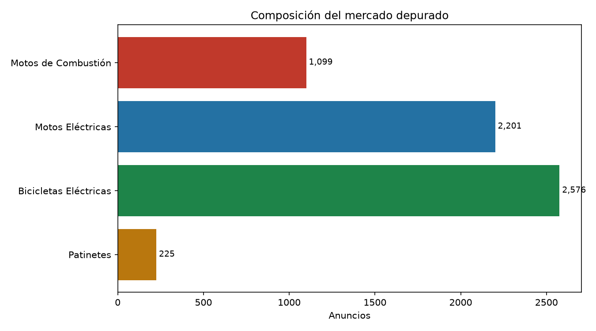
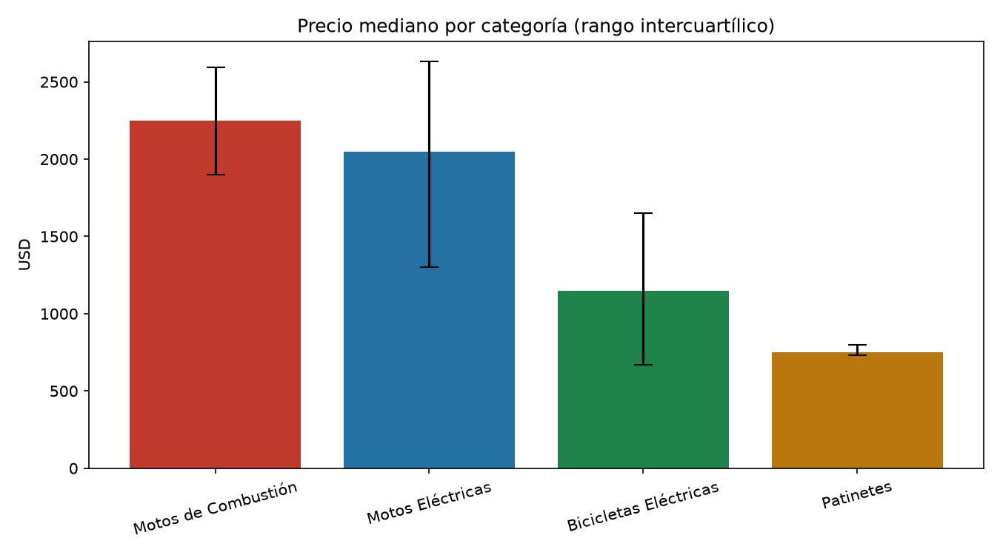
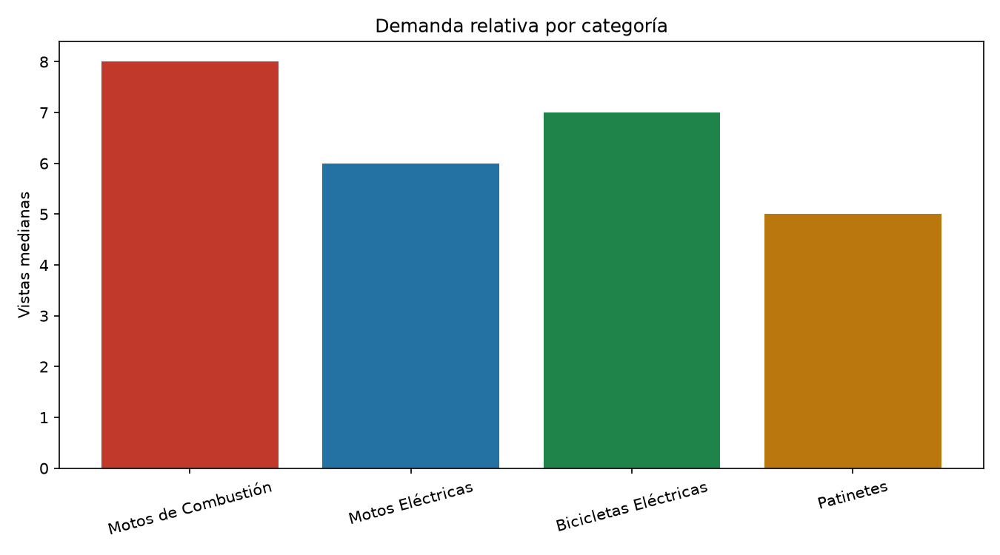
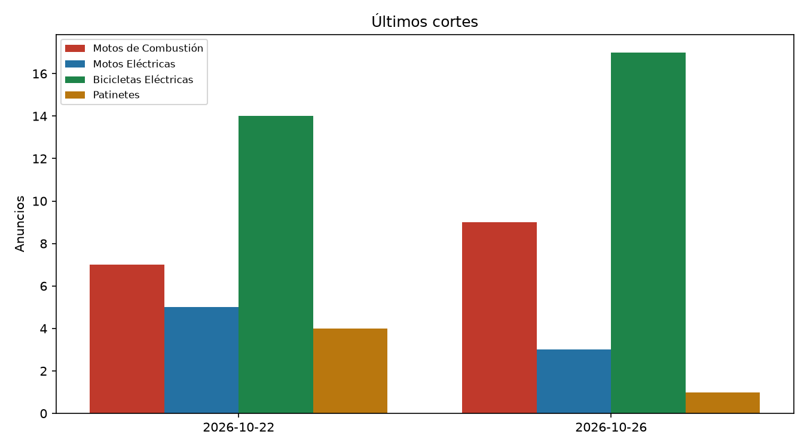
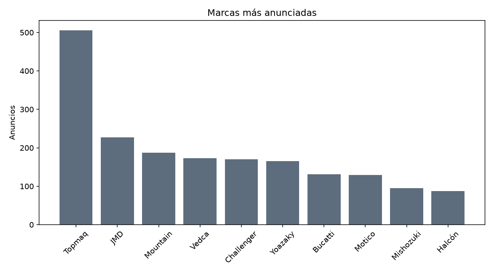

# Mercado de motos en Cuba

Informe generado el 2026-10-29 a partir de 6,101 anuncios depurados.

El dataset público contiene únicamente las cuatro categorías oficiales del proyecto.

## Composición

| Categoría | Anuncios | Precio mediano USD | P25 USD | P75 USD | Vistas medianas |
|---|---:|---:|---:|---:|---:|
| Motos de Combustión | 1,099 | 2250.0 | 1900.0 | 2592.5 | 8 |
| Motos Eléctricas | 2,201 | 2050.0 | 1300.0 | 2630.0 | 6 |
| Bicicletas Eléctricas | 2,576 | 1150.0 | 670.0 | 1650.0 | 7.0 |
| Patinetes | 225 | 750.0 | 730.0 | 800.0 | 5 |

## Precios

## Demanda

## Últimos cortes

| Corte | Anuncios | Motos de Combustión | Motos Eléctricas | Bicicletas Eléctricas | Patinetes |
|---|---:|---:|---:|---:|---:|
| 2026-10-22 | 30 | 7 | 5 | 14 | 4 |
| 2026-10-26 | 30 | 9 | 3 | 17 | 1 |

## Marcas

| Marca | Anuncios |
|---|---:|
| Topmaq | 506 |
| JMD | 227 |
| Mountain | 187 |
| Vedca | 173 |
| Challenger | 170 |
| Yoazaky | 165 |
| Bucatti | 131 |
| Motico | 129 |
| Mishozuki | 95 |
| Halcón | 87 |

## Fuentes y método

- Fuente: anuncios públicos de Revolico (La Habana).
- Moneda de los precios: USD; los anuncios en CUP se conservan para conteo, pero no entran en las estadísticas de precio.
- La clasificación usa las cuatro categorías oficiales y un proceso de deduplicación por identificador y por repetición exacta.
- Los datos se publican en `data_clean/`; los crudos depurados están en `data_raw/revolico/`.
