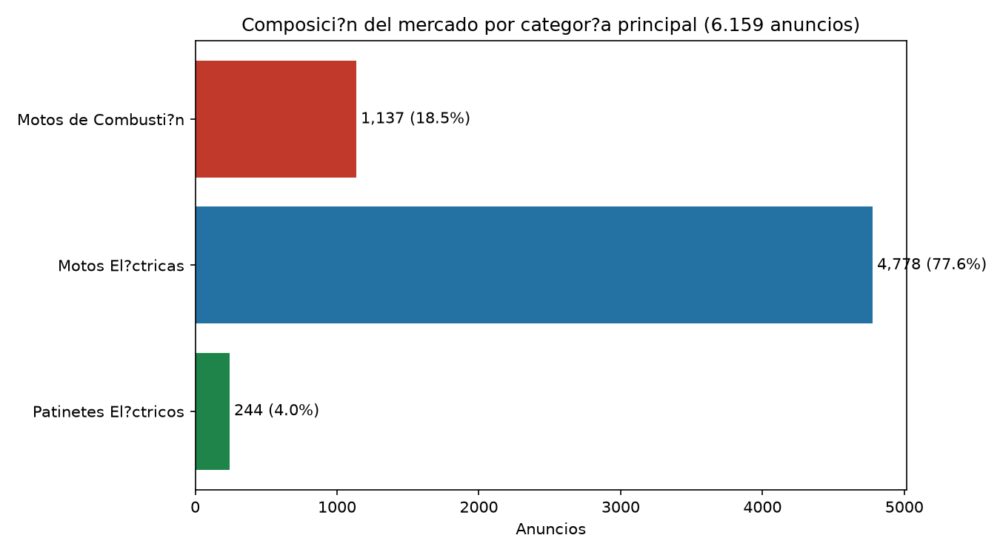
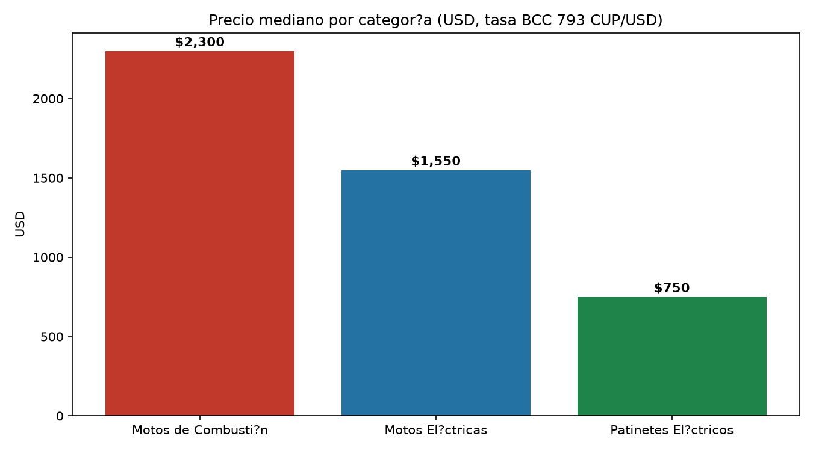
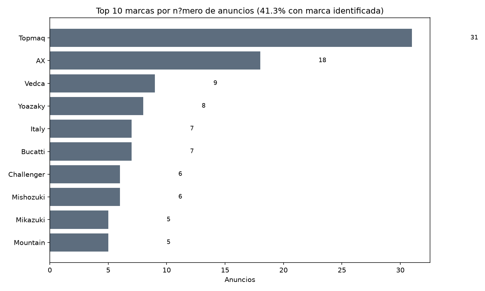
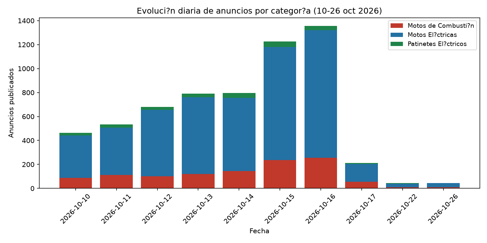
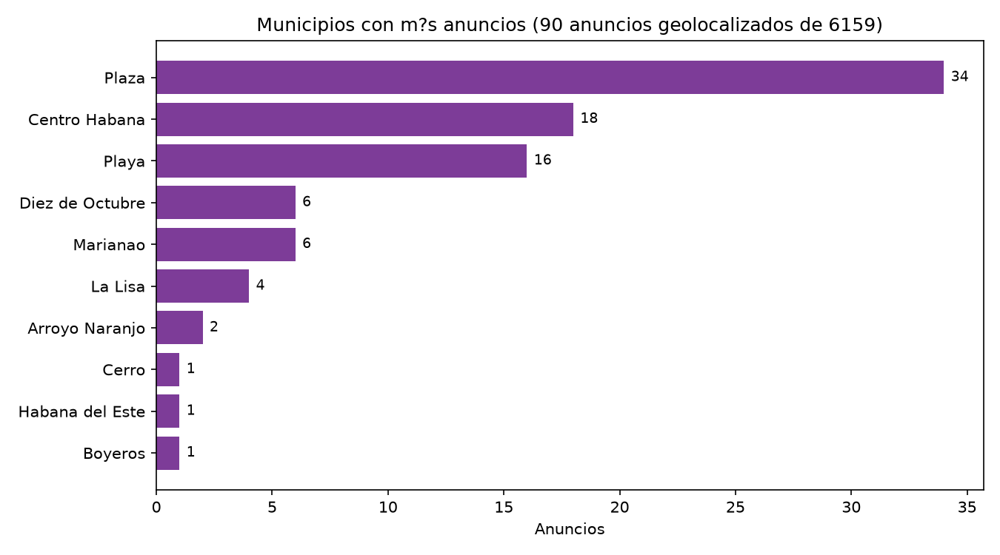

# Mercado de motos en La Habana

Informe generado el 2026-11-06 a partir de 6,159 anuncios depurados de Revolico (La Habana).
Fuente: anuncios públicos de Revolico, 10 al 26 de octubre de 2026.
Tasa BCC: 1 USD = 793,00 CUP (06/11/2026).

## Categorías principales

El proyecto utiliza tres categorías principales: combustión, eléctrica y scooter (patinetes eléctricos). Cada anuncio pertenece a exactamente una categoría.

| Categoría principal | Anuncios | % del total |
|---|---:|---:|
| Motos Eléctricas | 4,778 | 77.6% |
| Motos de Combustión | 1,137 | 18.5% |
| Patinetes Eléctricos | 244 | 4.0% |
| **Total** | **6,159** | **100.0%** |

## Precios

Los precios se cotizan en USD (99.4% de los anuncios). Los anuncios en CUP (37) se conservan para conteo pero no entran en las estadísticas de precio.

| Categoría | Precio mediano USD | Equivalente CUP (793) | Rango USD |
|---|---:|---:|---:|
| Motos de Combustión | 2,300 | 1,823,900 | 50 – 26,000 |
| Motos Eléctricas | 1,550 | 1,229,150 | 50 – 111,111 |
| Patinetes Eléctricos | 750 | 594,750 | 50 – 1,250 |

## Marcas más anunciadas

Solo el 41.3% de los anuncios (2,545 de 6,159) menciona una marca reconocible en el título. El 58.7% restante no declara marca.

| Marca | Anuncios | Precio mediano USD |
|---|---:|---:|
| Topmaq | 506 | 2,400 |
| JMD | 235 | 1,500 |
| Mountain | 187 | 2,300 |
| Vedca | 174 | 1,600 |
| Yoazaky | 171 | 1,800 |
| Challenger | 170 | 820 |
| Bucatti | 131 | 2,000 |
| Motico | 129 | 850 |
| Mishozuki | 95 | 1,950 |
| MAF | 71 | 1,100 |

## Evolución diaria

| Fecha | Combustión | Eléctrica | Scooter | Total |
|---|---:|---:|---:|---:|
| 2026-10-10 | 88 | 354 | 22 | 464 |
| 2026-10-11 | 112 | 395 | 28 | 535 |
| 2026-10-12 | 102 | 553 | 26 | 681 |
| 2026-10-13 | 121 | 639 | 32 | 792 |
| 2026-10-14 | 143 | 613 | 39 | 795 |
| 2026-10-15 | 236 | 943 | 47 | 1,226 |
| 2026-10-16 | 255 | 1,067 | 35 | 1,357 |
| 2026-10-17 | 55 | 149 | 7 | 211 |
| 2026-10-22 | 10 | 29 | 6 | 45 |
| 2026-10-26 | 10 | 33 | 2 | 45 |

## Geolocalización (municipios de La Habana)

Solo 105 de 6,159 anuncios (1.70%) tienen municipio identificable en el título o descripción. El resto no declara ubicación específica.

| Municipio | Anuncios |
|---|---:|
| Plaza de la Revolución | 35 |
| Centro Habana | 19 |
| Playa | 16 |
| La Lisa | 10 |
| Diez de Octubre | 9 |
| Marianao | 7 |
| Arroyo Naranjo | 2 |
| Cerro | 1 |
| Habana del Este | 1 |
| Boyeros | 2 |
| Cotorro | 1 |
| Regla | 1 |
| San Miguel del Padrón | 1 |
| Guanabacoa | 0 |

## Fuentes y método

- Fuente: anuncios públicos de Revolico (La Habana), cortes del 10 al 26 de octubre de 2026.
- Moneda de los precios: USD; los anuncios en CUP se conservan para conteo pero no entran en las estadísticas de precio.
- Tasa BCC: 1 USD = 793,00 CUP (06/11/2026).
- Clasificación jerárquica: cada anuncio pertenece a una categoría principal (combustión, eléctrica, scooter) y una subcategoría de Revolico.
- Los datos se publican en `data/processed/`; los crudos depurados están en `data/raw/revolico/`.